  

# ?? Awesome-Load-Balancers: Top Load Balancers Ecosystem

  
  
  
  
  
  

> ?? **A curated directory and comparative guide of Application Delivery Controllers (ADC), SaaS load balancing services, reverse proxies, and open-source traffic management software.**

*Focused on Layer 4 (TCP/UDP) & Layer 7 (HTTP/HTTPS/gRPC) Traffic Distribution, High Availability, Kubernetes Ingress, Service Mesh Data Planes, and Self-Hosted Proxy Infrastructure.*

---

## ?? Table of Contents

- [?? Sector Overview & Market Dynamics](#-sector-overview--market-dynamics)
- [?? SaaS & Hosted Platforms](#?-saas--hosted-platforms)
- [?? Open-Source GitHub Projects](#-open-source-github-projects)
  - [Top Tier Load Balancers & Proxies](#top-tier-load-balancers--proxies)
  - [Specialized & High-Throughput Solutions](#specialized--high-throughput-solutions)
- [?? How to Contribute](#-how-to-contribute)
- [?? Support](#-support)
- [?? Star History](#-star-history)
- [?? Disclaimer](#-disclaimer)

---

## ?? Sector Overview & Market Dynamics

The global Application Delivery Controller (ADC) and Load Balancer market is estimated at **$7B-$9B** (projected to exceed **$20B+ by the mid-2030s** at an estimated 10%-16% CAGR). Historically concentrated around legacy hardware ADC incumbents, the sector is now **moderately fragmented** as enterprises transition to software-defined proxies, multi-cloud architectures, Kubernetes ingress, and hyper-scaler consumption-based services rather than relying on a single winner-take-all platform.

---

## ?? SaaS & Hosted Platforms

| Product / Platform | Company Valuation / Revenue Scale | Starting Pricing | Free Tier / Trial Limits | Key Focus & Deployment |
| :--- | :--- | :--- | :--- | :--- |
| **[Azure Load Balancer](https://azure.microsoft.com/en-us/products/load-balancer/)** (Microsoft) | **~$3.1T** Market Cap / **~$245B** FY24 Revenue | **$0.025/hour** (first 5 rules baseline) + **$0.005/GB** data processed | **30-day trial with $200 Azure credits** (Standard SKU has no ongoing free allowance; Basic SKU retired Sept 2025) | Azure-native L4 load balancing with Availability Zone redundancy and inbound NAT. |
| **[AWS Elastic Load Balancing (ELB)](https://aws.amazon.com/elasticloadbalancing/)** (Amazon AWS) | **~$1.9T** Market Cap / **~$105B+** AWS ARR | **$0.0225/hour** + **$0.008/LCU-hour** (ALB baseline) | **750 hours/month** shared across ALBs/NLBs + **15 LCUs/month** for the first **12 months** (new AWS accounts) | Native AWS L4 (NLB), L7 (ALB), and Gateway (GWLB) managed traffic routing. |
| **[F5 BIG-IP](https://www.f5.com/)** (F5, Inc.) | **~$15B** Market Cap / **~$3.09B** FY25 Revenue | **$0.35/hour** (entry-level 25 Mbps GOOD bundle on AWS Marketplace PAYG) | **30-day free trial** on AWS Marketplace utility instances (infrastructure fees apply) | Enterprise-grade ADC standard with advanced L4-L7 traffic management, iRules, and SSL offloading. |
| **[Citrix ADC (NetScaler)](https://www.citrix.com/)** (Cloud Software Group) | **~$8.2B** EV / **~$3.2B+** Annual Revenue Scale | **$5,000/year** (standalone VPX Advanced subscription starting tier) | **Free forever tier: NetScaler VPX Express** capped at **20 Mbps throughput** (also offers **21-day trial** for full VPX) | Enterprise ADC offering L4-L7 traffic acceleration, SSL offload, and native Citrix ecosystem integration. |
| **[Kemp LoadMaster](https://kemptechnologies.com/)** (Progress Software) | **~$2.0B** Market Cap / **~$978M** FY25 Revenue | **$0.38/hour** (PAYG software utility tier on cloud marketplaces) | **Free forever tier: LoadMaster FREE (VLM-FREE)** capped at **20 Mbps throughput** & **50 SSL TPS** (community support) | High-value, mid-market virtual ADC for SMBs and enterprise edge environments without appliance licensing overhead. |
| **[A10 Networks Thunder ADC](https://www.a10networks.com/)** (A10 Networks) | **~$1.3B** Market Cap / **~$290M** FY25 Revenue | **$0.97/hour** (200 Mbps throughput tier software license on AWS Marketplace) | **30-day free trial** on AWS Marketplace metered tiers (infrastructure fees apply) | High-performance ADC engineered for hardware/virtual high-throughput, integrated DDoS protection, and SSL inspection. |

---

## ?? Open-Source GitHub Projects

Curated list of leading open-source load balancers, reverse proxies, and traffic directors, sorted by GitHub stargazers.

### Top Tier Load Balancers & Proxies

- **[Caddy](https://github.com/caddyserver/caddy)**   
  ? **The modern, automated web server and reverse proxy.** Features automatic HTTPS with Let's Encrypt / ZeroSSL, native HTTP/2 & HTTP/3 support, dynamic JSON config API, modular Go architecture, and intuitive Caddyfile configuration. Best for fast deployments requiring zero-friction TLS management.

- **[Traefik](https://github.com/traefik/traefik)**   
  ? **The cloud-native, orchestrator-aware reverse proxy.** Connects directly to Docker, Kubernetes, Consul, and AWS ECS to automatically generate routes and certificates in real time without downtime or manual reload. Best for microservice and containerized architectures.

- **[Kong Gateway](https://github.com/Kong/kong)**   
  ? **Cloud-native API gateway and L7 traffic orchestrator.** Built on OpenResty/NGINX engine with Lua/Wasm plugin extensibility, active load balancing, zero-downtime reconfiguration, rate-limiting, authentication, and gRPC routing. Best for enterprise API management and microservices ingress.

- **[NGINX](https://github.com/nginx/nginx)**   
  ? **The ubiquitous battle-tested web server and reverse proxy.** Provides asynchronous event-driven L4 (Stream) and L7 (HTTP) load balancing (round-robin, least connections, ip-hash), HTTP/3 support, SSL termination, and high-concurrency static caching. Best for general-purpose web serving, caching, and edge routing.

- **[Envoy](https://github.com/envoyproxy/envoy)**   
  ? **Cloud-native high-performance edge/middle/service proxy.** CNCF Graduated C++ proxy designed for cloud-native architectures, featuring dynamic configuration via xDS APIs, native gRPC routing, circuit breaking, advanced health checking, and deep distributed tracing observability. Standard data-plane for modern service meshes (Istio, Cilium Service Mesh).

- **[Cilium](https://github.com/cilium/cilium)**   
  ? **eBPF-powered high-performance networking, observability, and load balancing.** Replaces kube-proxy with kernel-level eBPF L4 load balancing (XDP), Maglev consistent hashing, mutual TLS, and integrated Ingress / Gateway API support. Best for high-scale Kubernetes clusters seeking near-hardware throughput.

- **[Kubernetes Ingress-NGINX](https://github.com/kubernetes/ingress-nginx)**   
  ? **The community standard Kubernetes Ingress Controller.** Uses NGINX as a reverse proxy and load balancer to expose HTTP and HTTPS routes from outside the cluster to services within the cluster.

- **[Apache APISIX](https://github.com/apache/apisix)**   
  ? **Dynamic, real-time, high-performance Cloud-Native API Gateway & Load Balancer.** Apache Top-Level Project based on NGINX and LuaJIT with etcd dynamic sync, handling traffic distribution, security filtering, canary releases, and full lifecycle API routing without reloads.

- **[MetalLB](https://github.com/metallb/metallb)**   
  ? **Bare-metal network load-balancer implementation for Kubernetes.** Provides a network load balancer implementation for Kubernetes clusters that do not run on a standard cloud provider, using standard routing protocols like ARP/NDP (Layer 2) and BGP.

- **[HAProxy](https://github.com/haproxy/haproxy)**   
  ? **The gold standard for ultra-low latency L4 & L7 load balancing.** Legendary event-driven multi-threaded proxy delivering world-class throughput, strict connection pooling, comprehensive health checks, seamless runtime APIs, and rock-solid stability under millions of concurrent connections.

- **[Katran](https://github.com/facebookincubator/katran)**   
  ? **Ultra-fast L4 network load balancer powered by Linux eBPF and XDP.** Developed and battle-tested by Meta (Facebook) to power their global infrastructure, leveraging kernel bypass techniques for maximum packet per second (PPS) throughput and Maglev hashing.

- **[Emissary-Ingress](https://github.com/emissary-ingress/emissary)**   
  ? **Kubernetes-native API Gateway & Ingress Controller powered by Envoy.** CNCF incubating project providing declarative CRD-driven configuration, gRPC/HTTP2 load balancing, rate limiting, and OAuth/OIDC integration for cloud-native Kubernetes workloads.

- **[Envoy Gateway](https://github.com/envoyproxy/gateway)**   
  ? **Standardized Kubernetes Gateway API provider powered by Envoy Proxy.** Simplifies operating Envoy as an application gateway and load balancer in Kubernetes using the modern Gateway API specification.

### Specialized & High-Throughput Solutions

- **IPVS (IP Virtual Server)** ? Built into the Linux kernel, IPVS implements high-performance Layer-4 transport-layer load balancing (TCP/UDP) with direct routing (DR), NAT, and tunneling modes, handling tens of millions of packets per second.

---

## ?? How to Contribute

Contributions are always welcome! Help keep this load balancer ecosystem complete and up to date:

1. ?? **Fork** the repository on GitHub.
2. ?? **Create a new branch** (`git checkout -b add-load-balancer-tool`).
3. ?? **Add or update entries** following existing alphabetical and tabular formats (verify factual details and official docs).
4. ?? **Commit your changes** (`git commit -m 'Add awesome load balancer'`).
5. ?? **Push to the branch** (`git push origin add-load-balancer-tool`).
6. ?? **Open a Pull Request** with a concise description of your additions.

---

## ?? Support

If you find this curated collection useful, please consider:
- ? **Starring** the repository on GitHub to boost visibility.
- ?? **Forking** and contributing new tools, benchmarks, and updates.
- ?? **Sharing** with your DevOps, SRE, and Infrastructure engineering peers.
- ? **Buying a coffee / sponsoring** ongoing maintenance via the [GitHub Sponsor Dashboard](https://github.com/sponsors/ishandutta2007).

---

## ?? Star History

---

## ?? Disclaimer

- This is a **community-curated** list ? not exhaustive and not an endorsement.
- **HAProxy vs NGINX vs Envoy is not a winner-take-all question**: HAProxy excels at raw throughput and sub-millisecond tail latency at high concurrency; NGINX excels as an all-in-one web server, static cache, and reverse proxy; Envoy excels as a cloud-native dynamic microservice mesh data plane.
- **Enterprise ADC features (F5, Citrix, Kemp, A10)** include dedicated hardware acceleration ASICs, global server load balancing (GSLB), and vendor enterprise support SLAs that general-purpose open-source tools require separate operational management for.

---

  <b>Made with ?? for infrastructure engineers, SREs, and cloud architects building resilient systems.</b>

